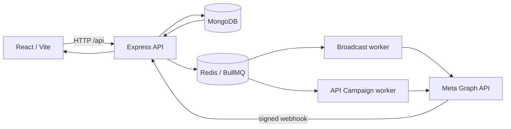

# EngageFlow

EngageFlow is a WhatsApp-first customer-engagement application. The repository contains a React dashboard, an Express API, MongoDB persistence, two Redis/BullMQ sending pipelines, and Meta WhatsApp Cloud API integration. It has working code for setup, templates, audience, Broadcast, API Campaigns, and Inbox; it is **not yet a verified production multi-tenant SaaS**. In particular, normal application routes do not have trusted login/RBAC, and live Meta, scale, and deployment behavior require independent verification.

## Contents

- [Architecture and code map](docs/architecture.md)
- [MongoDB models and indexes](docs/database.md)
- [Registered API endpoints](docs/api-reference.md)
- [Redis, queues and workers](docs/queues-workers.md)
- [WhatsApp/Meta lifecycle](docs/whatsapp-meta.md)
- [Developer handover, tests and troubleshooting](docs/developer-handover.md)
- Existing feature notes: [Broadcast](docs/features/broadcast-campaigns.md), [API Campaigns](docs/features/api-campaigns.md), [Setup](docs/features/whatsapp-setup.md), [WABA isolation](docs/features/waba-isolation.md).

## At a glance

| Area | Implemented in code | Important qualification |
| --- | --- | --- |
| Setup and Embedded Signup | Asset storage, refresh/reconciliation, Standard registration, guarded Coexistence path | Real Meta eligibility, App Review, onboarding and webhook subscription require live verification. |
| Templates and audience | Meta sync/authoring/library; contacts, consent, tags, segments, CSV operations | Provider approval and imported consent evidence must be checked; tags are embedded, not a separate model. |
| Broadcast | Draft/edit/duplicate/schedule, snapshot, queue/worker, statuses, retry UI/API | Controlled staging, provider-wide pacing and crash/timeout recovery need verification. |
| API Campaigns | Credentials, external trigger, rate limiting, idempotency, queue/worker, executions and retries | Production auth for dashboard routes and multi-attempt index/correlation rollout need review. |
| Inbox | Signed inbound webhooks, conversations, replies, status tracking | Multi-agent permissions and automation are not implemented. |
| Operations | Health endpoints, tests, builds, bounded workers | No claim of production throughput or real Meta readiness. |

## Stack and layout

The npm workspace uses React 19, React Router 7, Vite 8, TypeScript, Tailwind CSS 4, Express 5, Mongoose 9, BullMQ 6, ioredis 6 and Zod 4, according to package dependency ranges. Check the lockfile/installed packages for the exact deployed versions. `frontend/src/routes/router.tsx` owns browser routes; `frontend/src/services/api/client.ts` owns HTTP requests. `backend/src/server.ts` starts the API and MongoDB; `backend/src/app.ts` mounts routes. `backend/src/models`, `services`, `controllers`, `routes`, `middleware`, and `workers` carry the corresponding backend responsibilities. Feature notes live in `docs/features/`.

## Local start

Prerequisites: a Node/npm version compatible with the lockfile, MongoDB, and Redis. The source does not specify `engines`; the previous README's exact minimum versions were not independently established. Use a **separate non-production database, Redis instance, and Meta test setup**. Do not point a local worker at existing business data. There is no required seed script in the root scripts.

1. Run `npm install` from the repository root. Review `backend/.env.example` and `frontend/.env.example`; create local environment files only in your own development setup and never commit secrets.
2. Configure a non-production `MONGODB_URI`, `REDIS_URL`, `DEV_WORKSPACE_ID`, and frontend `VITE_API_URL` as appropriate. A workspace record and matching development workspace ID are needed for feature routes; health routes do not establish an application workspace. Keep `CAMPAIGN_TRANSPORT=disabled` and `CAMPAIGN_LIVE_SEND_ENABLED=false` unless a controlled, authorized send test is intended.
3. Run `npm run dev:backend` and `npm run dev:frontend` in separate terminals. Default ports are backend `5001` and Vite `5173` (changeable by environment/config).
4. Check `GET http://localhost:5001/api/health/live` and `/api/health/ready`; the latter reports dependency readiness. Open `http://localhost:5173` and verify a feature request with a valid development workspace.
5. Only when queue processing is intentionally required, run `npm run campaign:worker --workspace backend` and/or `npm run api-campaign:worker --workspace backend` in separate terminals. **Starting a worker against a real queue can send messages.** See [worker safety](docs/queues-workers.md).

## Environment variable names

The backend parser is `backend/src/config/env.ts`; sample names are in `backend/.env.example`. Defaults are useful for bootstrapping, not proof of production suitability.

| Group | Names and purpose |
| --- | --- |
| Server/data | `NODE_ENV` mode; `PORT` API port; `FRONTEND_ORIGIN` CORS origins; `MONGODB_URI` MongoDB; `REDIS_URL` queue/rate-limit Redis; `DEV_WORKSPACE_ID` non-production workspace resolver. |
| Broadcast | `CAMPAIGN_TRANSPORT` disabled/mock/meta selection; `CAMPAIGN_LIVE_SEND_ENABLED` live-send guard; `CAMPAIGN_TEST_BYPASS_CONSENT` non-production exception; `CAMPAIGN_WORKER_CONCURRENCY`, `CAMPAIGN_BATCH_SIZE` worker bounds. |
| API Campaign | `API_CAMPAIGN_WORKER_CONCURRENCY`; `API_CAMPAIGN_RATE_LIMIT_WINDOW_MS`, `API_CAMPAIGN_RATE_LIMIT_MAX`; `API_CAMPAIGN_TEST_BYPASS_CONSENT` non-production trigger exception (do not assume worker bypass). |
| Meta/security | `META_APP_ID`, `META_APP_SECRET`, `ENCRYPTION_KEY`, `WHATSAPP_API_VERSION`, `WEBHOOK_VERIFY_TOKEN`. Keep secret values server-side. |
| Frontend | `VITE_API_URL` API base URL. Setup's Embedded Signup code also reads public IDs `VITE_META_APP_ID` and `VITE_WHATSAPP_CONFIG_ID`; these are **missing from `frontend/.env.example`**. Never put an access token or app secret in a `VITE_` variable. |

## Verification commands

From the root: `npm run lint`, `npm run test`, `npm run build`, or `npm run check` (lint + test + build). Per-workspace commands include `npm run typecheck --workspace backend` and `npm run typecheck --workspace frontend`. These are available scripts, **not test results**; this documentation change did not require running the application or contacting external services.

## Production boundaries

Normal dashboard APIs use a fixed non-production workspace resolver, not user authentication/RBAC; do not expose them to multiple real customers as-is. External API Campaign triggers instead use hashed Bearer credentials and derive a workspace from the credential. MongoDB auto-index and auto-create are disabled: schema declarations do not prove indexes exist in a live database. Verify index rollout separately, especially retry-attempt correlation. Meta phone eligibility, templates, webhook configuration and Coexistence must be checked in an authorized environment. Read the [handover guide](docs/developer-handover.md) before changing these flows.
