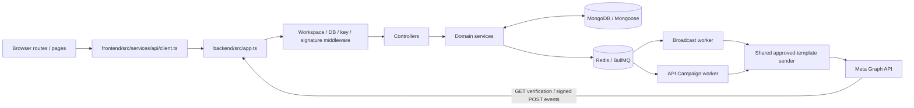

# Architecture and code map

EngageFlow is an npm workspace (`package.json`) with `frontend/` and `backend/`. It is WhatsApp-first despite the broader product name. The frontend uses React Router/Outlet and a shared HTTP client; no global Redux-style store is present. The backend is an Express 5 process plus **separate** BullMQ worker processes. MongoDB holds business history, while Redis holds queued work and API-trigger rate-limit counters.



## Entry points and ownership

| Location | Responsibility |
| --- | --- |
| `frontend/src/routes/router.tsx` | Dashboard routes, aliases, layouts and Outlet nesting. |
| `frontend/src/pages/`, `frontend/src/features/` | Feature pages and reusable feature UI; local hooks/state and form flow. |
| `frontend/src/services/api/client.ts` | Base URL normalization, HTTP/error handling and request timeout. |
| `backend/src/server.ts`, `backend/src/app.ts` | API lifecycle, middleware order and route mounting. |
| `backend/src/routes/`, `controllers/`, `services/` | URL contracts, request validation, orchestration and domain work. |
| `backend/src/models/`, `config/database.ts` | 15 Mongoose models and database connection. `autoIndex` and `autoCreate` are disabled. |
| `backend/src/config/*queue*.ts`, `backend/src/workers/` | BullMQ queues, producers, processors and worker lifecycle. |
| `backend/src/middleware/`, `backend/src/types/workspace.ts` | Workspace resolver, API-key authentication, Redis rate limiting and error boundaries. |
| `backend/src/services/whatsapp/`, `backend/src/controllers/whatsapp-webhook.controller.ts` | Meta asset/credential management, sending and webhook handling. |
| `backend/tests/`, frontend test files | Automated tests; their existence is not evidence of live-provider success. |

## Trust boundaries

`backend/src/app.ts` mounts health routes without feature workspace requirements. Ordinary `/api/whatsapp`, `/api/audience`, `/api/campaigns`, `/api/inbox`, `/api/api-campaigns`, credential and execution-log routes use `requireWorkspace` and `requireDatabase`. `backend/src/types/workspace.ts` resolves the **fixed** `DEV_WORKSPACE_ID` outside production; it does not authenticate a user. In production, absent a trusted resolver these routes fail closed, rather than becoming a working multi-tenant login system. Do not accept a client-supplied workspace ID as authority.

The external trigger endpoints use `apiKeyAuth`, which hashes and looks up a Bearer key and derives the workspace from the active `ApiCredential`; a Redis-backed limiter follows. The webhook route receives raw bytes before JSON parsing so its Meta signature can be checked. Every new data query and mutation should include server-derived workspace and, for sender-bound data, the original account/phone binding. See [WABA isolation](features/waba-isolation.md).

## Main data paths

```mermaid
sequenceDiagram
  participant UI as Browser / external client
  participant API as Express
  participant DB as MongoDB
  participant Q as BullMQ / Redis
  participant W as Worker
  participant M as Meta
  UI->>API: Create/launch Broadcast or trigger API Campaign
  API->>DB: Validate workspace, sender, template, consent; persist snapshot/execution
  API->>Q: Enqueue bounded job
  Q->>W: Claim job
  W->>DB: Revalidate and atomically claim work
  W->>M: Shared approved-template send
  M-->>W: Acceptance / definitive error / ambiguous outcome
  W->>DB: Persist message and attempt state
  M->>API: Signed delivery/inbound webhook
  API->>DB: Correlate wamid, update status and campaign/execution
  UI->>API: Poll details/analytics
  API-->>UI: Workspace-scoped state
```

An HTTP acceptance is not a delivered message. Delivery/read/failure require later Meta webhook evidence. An ambiguous provider timeout must not be treated as safe permission to resend. A worker must be started separately from the API; API process health alone does not imply queued jobs will progress.
